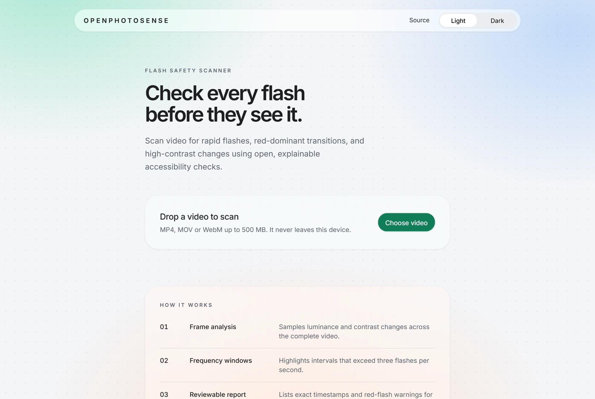
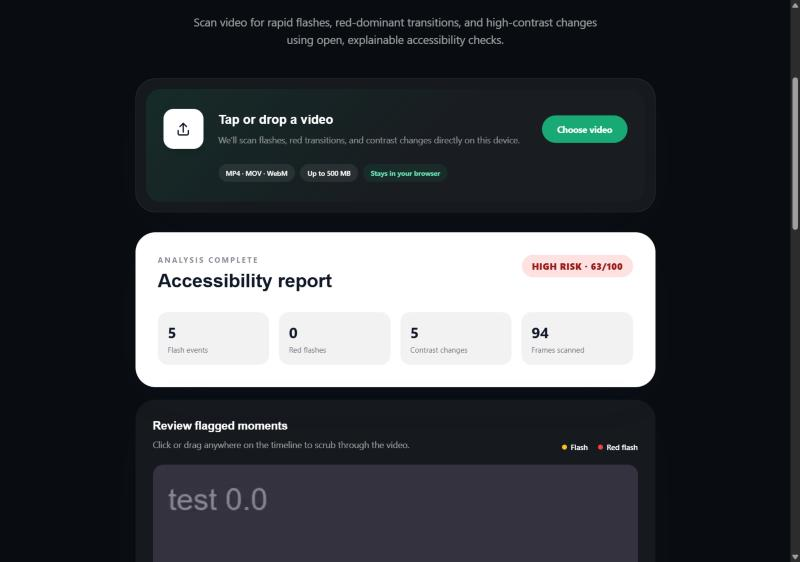
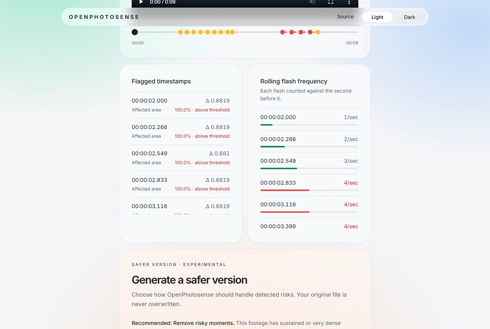
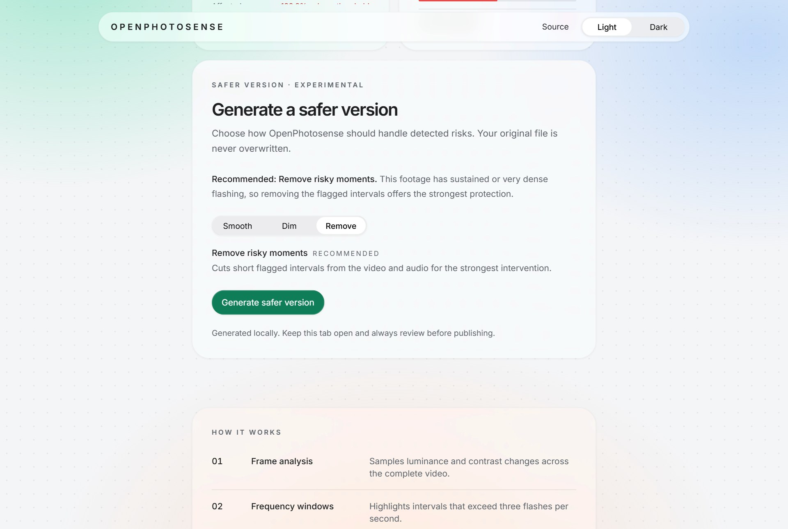

# OpenPhotosense

OpenPhotosense is a private, open-source browser tool for reviewing videos for potential photosensitive accessibility hazards before publishing.

Drop in a video and it checks for rapid luminance changes, red-dominant flashes, high-contrast transitions, and periods exceeding three flashes per second. Results include a risk score, exact timestamps, a highlighted video timeline, and safer-video options.

> **Important:** OpenPhotosense is an accessibility screening aid, **not a medical diagnostic tool**, certification service, or guarantee of WCAG conformance. Automated results can include false positives and false negatives. Human review remains necessary.

**[Try it live](https://abacked.github.io/OpenPhotosense/)**

## Screenshots

| Risk report | Flagged moments |
| --- | --- |
|  |  |

## No installation or upload required

The complete workflow runs inside the browser:

1. Drag in a video.
2. Review the risk report and highlighted timeline.
3. Choose the recommended correction or select another approach.
4. Preview and download the safer version.

Videos are decoded, scanned, corrected, and exported locally. They are never sent to an OpenPhotosense server, and users do not need an account, browser extension, Python, OpenCV, or FFmpeg.

## Features

- Drag-and-drop video scanning with live progress
- Low, medium, and high risk levels with an explainable score
- Exact flash timestamps and a draggable highlighted timeline
- Flash-frequency analysis based on the three-flashes-per-second guideline
- Separate red-flash and high-contrast warnings
- Original and corrected video previews
- Recommended correction based on the footage
- Smoothing, targeted dimming, and risky-interval removal
- MP4-first safer-video export with browser-compatible fallback
- Cancellable generation
- Responsive light and dark themes
- Reduced-motion support

## How detection works

The browser decodes every frame with WebCodecs into an off-screen canvas and converts sRGB pixels to relative luminance and CIE chromaticity. Each pixel tracks its own bright and dark extremes, so a change counts once it moves 10% from the last extreme, however many frames it takes. A frame registers a transition only when enough area changes in the same direction at once, so camera motion cancels out instead of looking like flashing. Two opposing transitions form one flash.

Every transition is evaluated in a rolling one-second window, preventing bursts from being split across fixed second boundaries. More than three flashes in any second is high risk; two or more, or any saturated-red flash, is medium. The score is the peak flash rate, scaled so the three-flash limit is 75.

Auto-fix recommendations use the same report:

- **Smooth** for brief, isolated luminance changes
- **Dim** when red-dominant flashes make up a significant share of warnings
- **Remove** for dense or sustained flashing

See the [detection methodology](docs/detection.md) for thresholds, limitations, and implementation details.

## Privacy

Selected videos remain on the user’s device. Browser object URLs, canvas processing, and media recording are used locally; OpenPhotosense does not retain or transmit the source video.

## Open source

Contributions are welcome. Read [CONTRIBUTING.md](CONTRIBUTING.md), review the [roadmap](ROADMAP.md), or open an issue with a reproducible example.

Licensed under the [Apache License 2.0](LICENSE).
